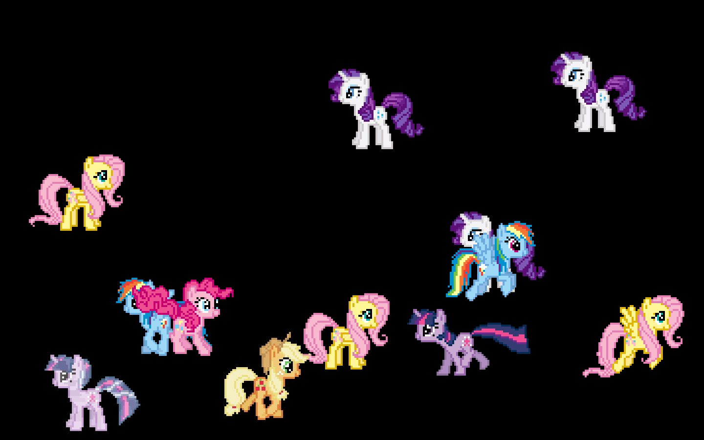

# Desktop Ponies for macOS

A native macOS screensaver adaptation of [Desktop Ponies](https://github.com/RoosterDragon/Desktop-Ponies), with 309 characters and a searchable cast picker.



Version **1.6** supports macOS 11 or later on Apple Silicon and Intel. The Mane Six preset shows exactly one of each character. Custom casts and random selections support up to 40 ponies. Options changes are reloaded by full-screen instances.

## Release status

Version 1.6 and its installer app are signed with Developer ID Application. **Apple notarization is pending** because Apple requires the developer account holder to accept an updated agreement. A notarized download will be published after Apple accepts the submission. No unnotarized download is labeled notarized.

## Install

The release disk image contains **Install Desktop Ponies 1.6.app**. Open the app and click **Install Screensaver**. It installs only for your account in `~/Library/Screen Savers` and preserves your saved settings. Click **Open Screen Saver Settings**, select **Desktop Ponies 1.6**, and open Options to choose your cast.

Older versions may remain installed. Select 1.6 to use this release. To uninstall, remove `Desktop Ponies 1.6.saver` from your account's Screen Savers folder.

## Build

Install Apple's Command Line Tools or Xcode, then run:

```sh
bash build.sh
bash build-installer-app.sh
```

These commands create development builds with ad-hoc signatures. For a Developer ID release, set `APPLICATION_SIGNING_IDENTITY` and `NOTARY_KEYCHAIN_PROFILE`, then run `bash release.sh`. Credentials remain in your local Keychain. The release script signs with hardened runtime and secure timestamps, submits to Apple, requires Accepted status, staples tickets, and checks Gatekeeper.

An optional conventional `.pkg` installer can be built with `bash build-installer.sh`. Set `INSTALLER_SIGNING_IDENTITY` to a **Developer ID Installer** identity to sign it. That certificate is distinct from the Application certificate used by the installer app.

## Verification

```sh
xcrun clang -fobjc-arc -O1 -framework Cocoa -framework ScreenSaver -framework ImageIO Source/Verify.m -o /tmp/ponies-verify
/tmp/ponies-verify "$PWD/Desktop Ponies 1.6.saver"
xcrun clang -fobjc-arc -O1 -framework Cocoa -framework ScreenSaver Source/SettingsVerify.m -o /tmp/ponies-settings-verify
/tmp/ponies-settings-verify "$PWD/Desktop Ponies 1.6.saver"
```

Additional edge and Rainbow Dash regression checks are in `Source/EdgeVerify.m` and `Source/RainbowVerify.m`. Compile them with Cocoa and ScreenSaver frameworks. Native validation covers picker behavior, all 1970 referenced assets, 2000 behavior transitions, full-size and thumbnail rendering, edge stability, and cross-process settings reloads. Intel compilation is verified; native runtime checks were performed on Apple Silicon.

The installer supports a test-only command that copies into a disposable directory without changing your actual installation:

```sh
'Install Desktop Ponies 1.6.app/Contents/MacOS/Installer' --test-install 'Desktop Ponies 1.6.saver' /tmp/ponies-install-test
```

## Scope and credits

This adaptation renders original GIF artwork and compatible standalone movement behaviors. Dialogue, effects, houses, games, following, linked behaviors, and character interactions are not implemented.

Original project: DesktopPonyGuy, RoosterDragon (Tom Roostan), and contributors. Artist credits are preserved in [UPSTREAM-CREDITS.txt](Resources/UPSTREAM-CREDITS.txt). My Little Pony characters belong to Hasbro.

Original artwork and this adaptation's source are distributed under **CC BY-NC-SA 3.0 Unported**. Noncommercial use only; retain attribution and share adaptations under the same license. See [LICENSE](LICENSE).
